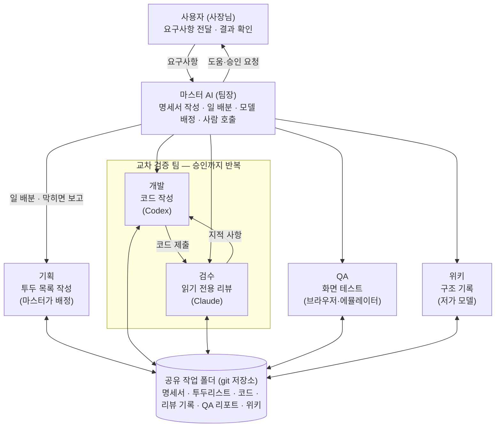
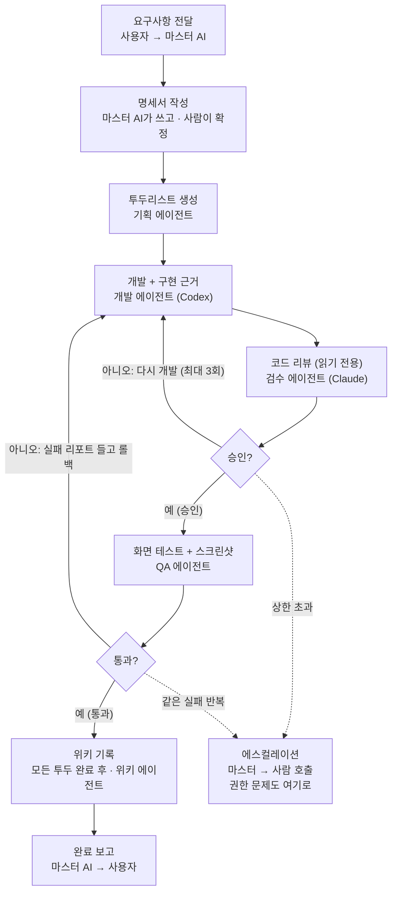
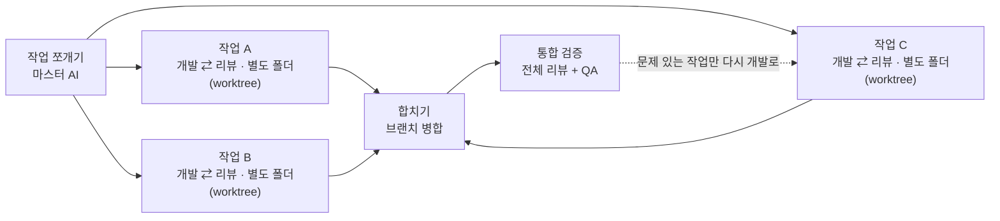
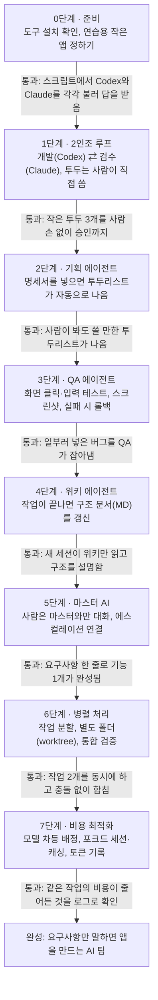

# 멀티 에이전트 자동 개발 시스템 — 분석 및 계획서

> 작성일: 2026-10-07 · 이 파일은 Claude Docs 원본 계획서의 마크다운 사본입니다 (2026-10-09 기준).

## 한눈에 보기

사람은 마스터 AI와만 대화하고, 마스터가 5개의 하위 에이전트에게 일을 나눠 맡기는 "팀장-팀원" 구조입니다. 사람이 AI 하나하나를 붙잡고 명령할 필요가 없습니다.



에이전트들은 서로 직접 대화하지 않고, 아래 공유 폴더의 파일로 일을 주고받습니다. 개발(Codex)과 검수(Claude)만은 승인이 날 때까지 결과물을 주고받는 한 팀으로 움직입니다.

## 에이전트별 역할

에이전트는 6개이고, 각자 자기 일에 꼭 필요한 권한만 가집니다. 회사로 치면 사장님(사용자) 아래에 팀장 1명과 팀원 5명이 있는 구조입니다.

| 에이전트 | 회사 비유 | 하는 일 | 권한 | 모델 등급 (시작값) |
| --- | --- | --- | --- | --- |
| 마스터 AI | 팀장 | 사람과 대화, 명세서 작성, 일 배분, 모델 배정, 사람 호출 | 모든 문서 읽기, 명세서 쓰기 | 고성능 |
| 기획 에이전트 | 기획자 | 명세서를 개발용·QA용 투두리스트로 쪼갬 | 투두리스트 쓰기 | 중~고성능 |
| 개발 에이전트 (Codex) | 개발자 | 투두 항목대로 코드 작성, 끝나면 구현 근거 제출 | 코드 수정 (작업 폴더 안에서만) | 코딩 특화 |
| 검수 에이전트 (Claude) | 선임 리뷰어 | 코드를 읽고 문제 지적, 승인 또는 반려 | 읽기 전용 (수정 금지) | 고성능 |
| QA 에이전트 | 테스터 | 실제 화면에서 클릭·입력 테스트, 스크린샷 증거, 실패 시 개발로 되돌림 | 앱 실행, 브라우저·에뮬레이터 조작 (코드 수정 금지) | 중간 |
| 위키 에이전트 | 기록 담당 | 끝난 작업의 구조와 결정을 MD 파일로 요약 | 위키 폴더만 쓰기 | 저가 |

모델 등급은 출발점일 뿐이고, 실제로는 마스터 AI가 작업 크기에 맞춰 바꿉니다 (아래 비용 최적화 분석 참고).

## 전체 작업 흐름

일 하나는 리뷰 승인과 QA 통과라는 두 관문을 모두 넘어야 완료됩니다. 어느 관문에서든 막히면 개발 단계로 돌아가고, 같은 문제가 반복되면 사람에게 넘어갑니다.



점선은 에스컬레이션(사람 호출) 경로입니다. 개발부터 QA까지는 투두마다 반복되고, 위키 기록은 모든 투두가 끝난 뒤 한 번 합니다.

각 투두는 아래 상태 중 하나를 갖습니다. 오케스트레이터는 이 상태를 보고 다음에 누구를 부를지 정합니다.

| 상태 | 뜻 | 다음 상태 |
| --- | --- | --- |
| 대기 | 투두가 만들어졌지만 아직 시작 전 | 개발중 |
| 개발중 | Codex가 코드를 쓰는 중 | 리뷰중 |
| 리뷰중 | Claude가 검토하는 중 | 승인 → QA중, 반려 → 개발중 |
| QA중 | 화면 테스트 중 | 통과 → 완료, 실패 → 개발중 |
| 완료 | 리뷰 승인과 QA 통과를 모두 마침 | (끝) |
| 에스컬레이션 | 반복 상한 초과나 권한 문제로 사람 판단을 기다림 | 사람이 결정한 뒤 다시 진행 |

## 교차 검증 루프 분석

교차 검증은 만드는 AI(Codex)와 검사하는 AI(Claude)를 서로 다른 회사 모델로 나눠, 한쪽이 놓친 실수를 다른 쪽이 잡게 하는 장치입니다. 같은 모델끼리는 같은 실수를 함께 놓치기 쉽습니다. 내가 쓴 글의 오타를 나 스스로는 잘 못 찾는 것과 비슷합니다.

**왜 검수자는 고치지 않고 말만 하나요?** 검수자가 직접 고치면 두 AI의 코드 스타일이 섞입니다. 작업자는 왜 바뀌었는지 모른 채 다음 일을 이어가서 흐름이 꼬입니다. 그래서 수정은 언제나 작업자가 직접 합니다.

**보완이 필요한 곳:** 원래 설계의 "승인이 날 때까지 무한 반복"은 이 구조에서 가장 큰 위험입니다. 승인 기준이 흐릿하면 루프가 끝나지 않고 비용만 쌓입니다. 아래 5가지 규칙을 함께 두는 것을 추천합니다.

| 규칙 | 내용 | 막아주는 문제 |
| --- | --- | --- |
| 지적 등급제 | 지적마다 필수 / 권장 / 참고 중 하나를 표시 | 무엇부터 고칠지 헷갈림 |
| 승인 기준 고정 | "필수" 지적이 0개면 승인 | 끝없는 트집 |
| 반복 상한 | 투두 1개당 리뷰 최대 3회 (시작값, 나중에 조정) | 무한 반복, 비용 폭발 |
| 근거 의무 | 지적할 때 파일 위치와 이유를 함께 적음 | 없는 문제를 지어내는 환각 |
| 반론 허용 | 작업자가 동의하지 않으면 이유를 적고, 같은 지점에서 2번 부딪히면 마스터가 판단 | 검수자의 잘못된 지적 |

상한을 넘기면 루프를 멈추고 에스컬레이션으로 넘깁니다 (아래 병렬 처리와 에스컬레이션 참고).

## 에이전트끼리 주고받는 문서

에이전트들은 긴 채팅 대신, 정해진 파일을 남기고 읽는 방식으로 일을 주고받습니다. 대화 기록 전체를 넘기지 않으니 토큰이 덜 들고, 누가 무엇을 했는지 기록이 남습니다. 아래 파일 이름은 예시입니다.

| 파일 (예시) | 쓰는 쪽 | 읽는 쪽 | 들어가는 내용 |
| --- | --- | --- | --- |
| spec.md (명세서) | 마스터 AI | 기획, 검수, QA | 만들 기능, 화면, 동작 조건, 만들지 않을 것 |
| todo.json (투두리스트) | 기획 (상태는 각 담당이 갱신) | 개발, QA, 마스터 | 항목 번호, 할 일, 완료 조건, 상태 |
| evidence/ (구현 근거) | 개발 | 검수, 마스터 | 바꾼 파일, 테스트 결과, 커밋 번호 |
| review/ (리뷰 기록) | 검수 | 개발, 마스터 | 지적 목록(등급·위치·이유), 승인 또는 반려 |
| qa/ (QA 리포트) | QA | 개발, 마스터 | 테스트 순서, 결과, 화면 캡처 |
| wiki/ARCHITECTURE.md | 위키 | 모든 에이전트 | 전체 구조, 주요 결정, 폴더 안내 |
| logs/ (작업·비용 기록) | 오케스트레이터 (자동 실행 프로그램) | 사람, 마스터 | 누가 언제 무엇을 했는지, 토큰 사용량 |

투두 항목 하나는 예를 들어 아래 모양입니다. 완료 조건(done_when)을 미리 적어두면 개발·검수·QA가 같은 기준으로 판단할 수 있습니다.

```json
{
  "id": "T-003",
  "title": "로그인 버튼 만들기",
  "done_when": "버튼을 누르면 홈 화면으로 이동한다",
  "status": "리뷰중",
  "review_round": 1,
  "evidence": "evidence/T-003.md"
}
```

## 병렬 처리와 에스컬레이션

일감이 크면 마스터 AI가 A·B·C로 쪼개 동시에 진행시키고, 합친 뒤에는 전체를 한 번 더 검증합니다. 따로따로 통과한 작업도 합치면 서로 부딪혀 깨질 수 있기 때문입니다.



각 작업은 자기 폴더 안에서 개발과 리뷰를 따로 반복하고, 통합 검증에서 문제가 나온 작업만 다시 개발로 돌아갑니다.

**병렬 처리 규칙**

- 서로 다른 파일·기능 단위로 쪼개서, 두 작업이 같은 파일을 고치지 않게 합니다.
- 작업마다 별도 폴더(git worktree)와 브랜치를 씁니다. 하나의 저장소를 여러 폴더로 펼쳐 놓는 git 기능입니다.
- 처음에는 동시에 2개까지만 돌립니다. 많이 돌릴수록 비용과 사용량 한도가 빨리 찹니다.

**에스컬레이션: 사람을 부르는 조건**

| 이럴 때 | 예시 | 누가 판단 |
| --- | --- | --- |
| 리뷰 반복 상한 초과 | 같은 투두가 3번 반려됨 | 사람 |
| 같은 에러 반복 | 같은 빌드 오류가 연속으로 남 | 사람 |
| 권한이 없음 | 결제 API 키가 필요함, 시스템 설정을 바꿔야 함 | 사람 |
| 명세에 없는 결정 | 디자인 선택, 기능 범위가 애매함 | 사람 |
| 작업자·검수자 의견 충돌 | 같은 지점에서 2번 부딪힘 | 마스터 AI (어려우면 사람) |
| 사용량 한도 도달 | 구독 한도가 바닥나 작업이 멈춤 | 사람 |

사람을 부를 때는 하려던 일, 막힌 곳, 시도한 방법, 고를 수 있는 선택지 2~3개를 함께 보내게 합니다. 그래야 사람이 빨리 결정하고 다시 맡길 수 있습니다.

## 비용 최적화 분석

비용은 두 가지로 줄입니다. 일에 맞는 모델을 고르는 것, 그리고 똑같은 앞부분을 다시 계산하지 않는 것(캐싱)입니다.

**구독 요금제 기준으로 바뀌는 점 (결정)**

| 항목 | API 종량제였다면 | 구독 요금제 (선택) |
| --- | --- | --- |
| 내는 돈 | 쓴 만큼 | 매달 고정 |
| 아껴야 할 것 | 돈 | 시간·주 단위로 다시 채워지는 사용량 한도 |
| 한도를 넘으면 | 비용이 늘어남 | 작업이 멈추고 한도가 채워질 때까지 기다림 |
| 지켜볼 것 | 토큰·금액 기록 | 남은 한도, 에이전트별 사용량 |

- 지금 공식 안내 기준으로 `claude -p`(헤드리스 모드) 사용도 구독 한도에서 차감됩니다. 이를 별도 크레딧으로 나누는 변경이 예고됐다가 보류된 상태라, 바뀌면 검수 에이전트 호출 방식을 다시 점검합니다 ([Anthropic 안내](https://support.claude.com/en/articles/15036540-use-the-claude-agent-sdk-with-your-claude-plan)).
- 구독 로그인은 공식 도구(Claude Code, Codex CLI)에서만 씁니다. 다른 회사 도구에 Claude 구독 로그인을 연결하는 것은 허용되지 않고, 요금제 한도도 평범한 개인 사용을 전제로 정해져 있습니다 ([Claude Code 법률·준수 안내](https://code.claude.com/docs/en/legal-and-compliance.md)). 그래서 쉬지 않고 도는 자동화는 한도에 빨리 닿습니다.
- 이 설계는 작업(Codex)과 검수(Claude)가 서로 다른 회사 구독을 쓰므로 부담이 자연스럽게 나뉩니다. 기획·QA·위키를 어느 쪽에 맡길지로 두 한도의 균형을 맞춥니다.

**모델 차등 배정.** 어려운 판단에만 비싼 모델을 쓰고, 양이 많은 반복 작업은 싼 모델에 맡깁니다.

| 일의 종류 | 예시 | 모델 등급 | 이유 |
| --- | --- | --- | --- |
| 어려운 판단 | 명세서 작성, 큰 설계, 코드 리뷰 | 고성능 | 여기서 틀리면 뒤 단계가 전부 틀어짐 |
| 정해진 작업 | 투두대로 코딩 | 코딩 특화·중간 | 양이 가장 많음 |
| 단순 반복 | QA 실행, 위키 요약, 로그 정리 | 저가 | 판단할 것이 적음 |

덧붙이면 좋은 규칙: 처음엔 싼 모델로 시도하고, 같은 투두에서 2번 실패하면 한 단계 좋은 모델로 올리는 "승급" 방식입니다. 대부분의 쉬운 일이 싼 모델에서 끝나서 평균 비용이 내려갑니다.

**캐싱이란?** 신입이 올 때마다 회사 소개를 1시간씩 다시 하는 대신, 소개 영상을 한 번 찍어두고 틀어주는 것과 같습니다. AI는 요청할 때마다 앞의 내용(규칙, 명세, 위키)을 처음부터 다시 읽습니다. 앞부분이 글자 하나까지 똑같으면, 저장해 둔 계산을 싸게 재사용합니다.

| 항목 | Claude(Anthropic) 기준 |
| --- | --- |
| 캐시에서 읽기 | 기본 입력 가격의 0.1배 (Opus 5.5는 0.05배) |
| 캐시에 저장 (5분 유지) | 기본 입력 가격의 1.25배 |
| 캐시에 저장 (1시간 유지) | 기본 입력 가격의 2배 |
| 유지 시간 | 기본 5분, 다시 쓸 때마다 연장 |
| 적중 조건 | 앞부분이 100% 똑같아야 함 |

출처: [Anthropic 프롬프트 캐싱 문서](https://platform.claude.com/docs/en/build-with-claude/prompt-caching). Codex(OpenAI)도 자체 캐싱이 있지만 할인율과 조건이 다르므로 OpenAI 요금표로 따로 확인해야 합니다. 이 숫자들은 API 요금 기준이라, 구독에서는 청구 금액이 아니라 한도 소모로 나타납니다.

**포크드 세션이란?** 공통 앞부분(프로젝트 규칙 + 명세 요약 + 위키 요약)을 담은 "시드 세션"을 한 번 만들고, 작업마다 그 시드를 복제(fork)해서 시작하는 방식입니다. 모든 작업의 앞부분이 똑같아지니 캐시가 잘 맞습니다. Claude Code에는 이어 하던 세션을 새 세션으로 갈라내는 `--fork-session` 옵션이 있습니다 ([CLI 참고 자료](https://mcp.directory/skills/cli-reference)).

작업자 시드와 리뷰어 시드를 나누는 이유는 두 가지입니다. 두 회사는 캐시를 서로 공유하지 않고, 역할 지시문도 서로 다르기 때문입니다.

| 시드 | 고정으로 담는 것 | 쓰는 쪽 | 캐시가 쌓이는 곳 |
| --- | --- | --- | --- |
| 작업자 시드 | 코딩 규칙, 명세 요약, 위키 요약 | 개발 (Codex) | OpenAI |
| 리뷰어 시드 | 리뷰 기준, 명세 요약, 위키 요약 | 검수 (Claude) | Anthropic |

**주의할 점**

- 시드에는 잘 안 바뀌는 내용만 넣고, 매번 바뀌는 투두 내용은 맨 뒤에 붙입니다. 앞부분이 한 글자만 달라도 캐시가 빗나갑니다.
- 병렬 작업은 시드 캐시가 만들어진 뒤에 출발시킵니다. 캐시는 첫 응답이 시작된 뒤에야 쓸 수 있습니다.
- 너무 짧은 내용은 캐시되지 않습니다. 모델마다 최소 길이가 있습니다 (예: Sonnet 5.5는 512토큰).
- "캐시 적중률 90%"는 목표치입니다. 실제 값은 응답에 찍히는 캐시 사용량을 로그로 모아서 확인합니다.
- 한도에 걸리면 작업을 실패로 끝내지 않고 멈춰 두었다가, 한도가 다시 채워지면 이어서 진행하도록 오케스트레이터를 만듭니다.

## 설계 분석: 장점·위험·보완

설계 방향은 탄탄합니다. 빠진 것은 "언제 멈출지"를 정하는 규칙과 "얼마나 썼는지"를 재는 장치, 이 두 가지입니다.

**이미 잘 설계된 부분**

| 설계 요소 | 좋은 점 |
| --- | --- |
| 단일 창구 (마스터 AI) | 사람이 신경 쓸 곳이 한 군데뿐 |
| 다른 회사 모델로 교차 검증 | 같은 실수를 함께 놓칠 확률이 낮아짐 |
| 읽기 전용 리뷰 | 코드 스타일과 작업 흐름이 섞이지 않음 |
| 구현 근거 강제 | "다 했어요"라는 거짓 완료를 막음 |
| 스크린샷 증거 QA | 사람이 결과를 눈으로 바로 확인 가능 |
| 위키 기록 | 다음 작업 때 처음부터 설명할 필요가 없음 |
| 에스컬레이션 | 막혔을 때 헛돌지 않고 사람에게 넘김 |

**위험 요소와 보완 방법**

| 위험 | 생기는 일 | 보완 방법 |
| --- | --- | --- |
| 무한 반복 | 리뷰·QA 루프가 안 끝나 한도를 다 써버림 | 반복 상한 + 넘으면 에스컬레이션 |
| 끝없는 트집 | 검수자가 사소한 지적을 계속함 | 지적 등급제, "필수"만 반려 사유 |
| 검수자 환각 | 없는 버그를 지적함 | 위치·근거 명시 의무, 작업자 반론 허용 |
| 모호한 명세 | 엉뚱한 기능이 만들어짐 | 명세 확정 전에 사람이 1번 승인 |
| 병렬 작업 충돌 | 같은 파일을 동시에 고쳐 코드가 꼬임 | 작업마다 별도 폴더(git worktree)·브랜치, 겹치지 않게 나누기 |
| 불안정한 QA | 화면 로딩 차이로 가짜 실패가 남 | 화면이 뜰 때까지 기다리기, 재시도 1번, 고정된 테스트 데이터 |
| 맥락 과다 | 위키·기록이 길어져 매번 비용 증가 | 위키는 짧은 요약본 유지, 오래된 기록은 따로 보관 |
| 권한 사고 | 에이전트가 중요한 파일이나 비밀키를 건드림 | 샌드박스 실행, 비밀키는 프롬프트에 넣지 않기, 배포는 사람 승인 |
| 한도 추적 불가 | 어디서 한도가 새는지 모름 | 에이전트별·투두별 사용량 기록, 하루 사용 상한 |
| 너무 크게 시작 | 처음부터 전부 만들다 지침 | 2인조 루프부터 단계적으로 (아래 로드맵) |

## 기술 도구 후보

처음에는 새 프레임워크 없이, 이미 있는 두 도구(Claude Code, Codex CLI)를 작은 스크립트로 이어 붙이는 방식이 가장 쉽습니다. 이 스크립트를 "오케스트레이터"라고 부르며, 에이전트들을 순서대로 불러주는 마스터 AI의 몸통 역할을 합니다.

| 역할 | 후보 도구 | 고른 이유 |
| --- | --- | --- |
| 오케스트레이터 | 처음: Python 스크립트 / 나중: Claude Agent SDK 또는 LangGraph | 처음엔 정해진 순서만 실행하면 충분하고, 병렬·분기가 많아지면 그래프 도구로 옮김 |
| 개발 (Codex) | Codex CLI 비대화형 실행: `codex exec --sandbox workspace-write` | 스크립트에서 부를 수 있고, 기본이 읽기 전용이라 쓰기 권한을 일부러 켜야 함 |
| 검수 (Claude) | Claude Code 헤드리스 모드: `claude -p` + `--allowedTools`로 읽기 도구만 허용 | 스크립트에서 부를 수 있고, 수정 도구를 막아 읽기 전용 리뷰를 강제 |
| 다음 라운드 이어가기 | `codex exec resume`, `claude --resume` | 같은 투두의 수정 라운드를 같은 맥락에서 이어감 |
| QA | 웹: Playwright (+ Playwright MCP) / 모바일: Maestro (+ Maestro MCP) | 브라우저와 에뮬레이터에서 클릭·입력·스크린샷을 자동화 |
| 병렬 작업 공간 | git worktree + 브랜치 | 작업마다 독립된 폴더라 서로 부딪히지 않음 |
| 규칙·위키 문서 | 저장소 안 마크다운: AGENTS.md(Codex용), CLAUDE.md(Claude Code용), wiki/ | 각 도구가 시작할 때 자기 규칙 파일을 읽음 |
| 상태·로그 | 처음: JSON 파일 / 나중: SQLite | 처음엔 파일이 가장 단순하고 눈으로 확인하기 쉬움 |

출처: [Codex 비대화형 모드 문서](https://developers.openai.com/pt-BR/docs/non-interactive-mode), [Claude Code 헤드리스 모드 문서](https://docs.claude.com/en/docs/claude-code/headless).

**체험용 지름길: 공식 Codex 플러그인.** OpenAI가 만든 Claude Code용 플러그인 [openai/codex-plugin-cc](https://github.com/openai/codex-plugin-cc)가 있습니다. `/codex:review`(읽기 전용 Codex 리뷰)와 `/codex:rescue`(Codex에게 작업 넘기기)를 제공합니다. `/codex:rescue`를 쓰면 "Claude가 지휘·검수, Codex가 작업"을 손으로 흉내 내볼 수 있어, 자동화 전에 교차 검증이 어떤 느낌인지 체험하기 좋습니다. 다만 자동 리뷰 게이트 기능은 Claude와 Codex의 루프가 길어져 사용량을 빨리 소모할 수 있다고 공식 안내에 경고되어 있습니다. 반복 상한이 꼭 필요한 이유이기도 합니다.

**지금 환경(Windows PowerShell + Claude Code) 기준 메모**

- 0단계에서 Codex CLI가 Windows에서 문제없이 도는지 먼저 확인하고, 문제가 많으면 WSL(윈도우 안의 리눅스)을 고려합니다.
- 경로 구분자(\ 와 /) 차이로 스크립트가 깨지기 쉬우니, 오케스트레이터는 OS 차이를 덜 타는 Python이 무난합니다.
- Codex 플러그인도 Windows 관련 수정이 여러 번 있었으니 최신 버전을 씁니다 ([릴리스 기록](https://github.com/openai/codex-plugin-cc/releases)).

## 웹·모바일 기술 스택과 QA 전략

웹은 Next.js(React)로, 모바일은 같은 React 방식으로 앱을 만드는 React Native(Expo)로 확정했습니다. 모바일은 앱스토어에 올리는 진짜 앱입니다. 둘 다 TypeScript로 쓰면 타입과 로직 코드를 함께 나눠 쓸 수 있습니다.

**기술 스택 (확정)**

| 구분 | 기술 | 고른 이유 |
| --- | --- | --- |
| 웹 앱 | Next.js (React) + TypeScript | React 기반 웹 프레임워크로, 화면과 서버 코드를 한 프로젝트에서 다룸 |
| 모바일 앱 | React Native (Expo) + TypeScript | React 문법 그대로 iOS·Android 앱을 만들고, Windows에서도 iOS 빌드 가능 |
| 공통 코드 | 한 저장소 안에 web / mobile / shared 폴더 | 타입, API 호출, 입력값 검사 같은 로직을 한 번만 작성 |

주의할 점이 있습니다. React Native는 웹의 div 대신 View 같은 전용 부품을 씁니다. 그래서 화면 코드는 웹과 모바일이 따로이고, 로직과 타입만 함께 씁니다.

**플랫폼별 QA 도구**

| 테스트 대상 | 후보 도구 | 지금 PC(Windows)에서 |
| --- | --- | --- |
| 웹 (Next.js) | Playwright (+ Playwright MCP): Chromium·Firefox·WebKit 브라우저 자동 조작 | 가능 |
| Android 앱 | Maestro (+ Maestro MCP), Android 에뮬레이터 | 가능 |
| iOS 앱 | Expo 클라우드: EAS Build(빌드) + EAS Simulator(원격 iOS 시뮬레이터), 실제 iPhone에서는 Expo Go | 가능 — Mac 없이 클라우드로 |

출처: [Next.js Playwright 가이드](https://nextjs.org/docs/pages/guides/testing/playwright), [Maestro MCP 소개](https://testguild.com/agentic-ai-mobile-testing-maestro/), [Expo: Windows에서 iOS 앱 만들기](https://expo.dev/blog/build-ios-apps-on-windows-with-cloud-simulators). Expo는 Claude Code와 Codex가 원격 시뮬레이터를 다루도록 돕는 스킬도 제공합니다. 앱스토어에 출시하려면 Apple 개발자 계정과 Google Play 개발자 계정(둘 다 유료)이 필요합니다.

**AI는 만들고, 반복은 파일이 맡습니다**

- QA 에이전트는 처음에 MCP로 앱을 직접 눌러 보며 시나리오를 찾고, 그 시나리오를 테스트 파일(웹은 Playwright 테스트, 모바일은 Maestro YAML)로 저장합니다.
- 다음부터는 저장된 파일을 그대로 실행합니다. AI가 매번 화면을 보고 판단하지 않으니 빠르고 싸며, 결과도 매번 같습니다.
- 두 방식 모두 스크린샷 증거를 남깁니다.

**도입 순서**

- 연습용 첫 앱은 웹(Next.js) 하나로 시작하고, 3단계(QA 에이전트)도 Playwright로 웹부터 붙입니다.
- 웹이 안정되면 모바일 앱을 추가하고, Android 에뮬레이터 → iOS(Expo 클라우드) 순서로 QA를 넓힙니다.

## 단계별 구축 로드맵

처음부터 6개 에이전트를 한꺼번에 만들지 않고, 개발-검수 2인조 루프 하나를 먼저 완성한 뒤 한 단계씩 붙입니다. 단계마다 통과 기준을 넘어야 다음으로 갑니다.



1단계가 가장 중요합니다. 교차 검증 루프가 안정적으로 돌아야 나머지 에이전트를 붙여도 흔들리지 않습니다. 0~4단계 동안 마스터 AI 자리는 정해진 순서대로 실행하는 스크립트가 대신하고, 5단계에서 AI로 바꿉니다.

## 연습용 첫 앱: 일주일 식단 관리

첫 연습 앱은 월~일 일주일(7일) 동안의 아침·점심·저녁 식단을 짜고 관리하는 웹앱입니다. 화면이 적고 규칙이 단순해서, 에이전트 팀의 흐름(명세 → 투두 → 개발·검수 → QA)을 처음 시험하기에 알맞습니다.

**화면 구성 (초안)**

| 화면 | 하는 일 | 핵심 동작 |
| --- | --- | --- |
| 주간 식단표 | 월~일 × 아침·점심·저녁, 21칸을 한눈에 보기 | 칸을 누르면 메뉴 입력 화면으로 이동 |
| 메뉴 입력 | 한 끼의 메뉴와 재료 적기 | 저장, 수정, 지우기 |
| 장보기 목록 | 일주일치 재료를 한곳에 모아 보기 | 산 재료 체크하기 |

**처음 범위에서 뺄 것:** 로그인, 서버 데이터베이스, 영양 계산, 모바일 앱. 데이터는 처음엔 브라우저 저장소(localStorage, 브라우저 안에 작은 데이터를 저장하는 기능)에 둡니다. 모바일 앱은 웹이 안정된 뒤 Expo로 추가하며, 7칸은 휴대폰 화면에 좁으니 하루씩 넘겨 보는 화면으로 만듭니다.

**1단계(2인조 루프)용 투두 예시**

| 번호 | 할 일 | 완료 조건 |
| --- | --- | --- |
| T-001 | 주간 식단표 화면 만들기 | 월~일 7칸 × 아침·점심·저녁 3줄, 총 21칸이 보인다 |
| T-002 | 칸을 눌러 메뉴 입력·저장하기 | 입력한 메뉴가 해당 칸에 표시된다 |
| T-003 | 새로고침해도 식단 유지하기 | 새로고침 후에도 입력한 메뉴가 그대로 있다 |

이 3개를 사람 손 없이 승인까지 마치면 1단계 통과입니다. 장보기 목록은 그다음 투두로 넘깁니다. QA 단계에서는 "월요일 점심에 메뉴 입력 → 새로고침 → 그대로인지 스크린샷" 같은 시나리오를 테스트 파일로 저장해 반복합니다.

## 시작 전에 정해야 할 것

아래 질문의 답에 따라 도구와 규칙이 달라집니다. 정해지는 대로 체크해 두면 다음 단계(설계 상세화)로 바로 넘어갈 수 있습니다.

- [x] 어떤 앱을 만들 건가요? → 웹 + 모바일 앱으로 결정 (웹·모바일 기술 스택과 QA 전략에 반영)
- [x] 주로 쓸 언어와 프레임워크는 무엇인가요? (결정: React + Next.js, 모바일은 React Native(Expo))
- [x] 모바일은 어떤 형태로 만들까요? → 앱스토어에 올리는 진짜 앱(React Native·Expo)으로 결정. Expo 클라우드로 Mac 없이 iOS까지 만듭니다.
- [ ] 앱스토어 계정은 언제 만들까요? — Apple·Google Play 개발자 계정(유료)은 개발 초기에는 없어도 되고, 실제 iPhone 설치 테스트나 출시 단계에서 필요합니다.
- [x] 요금 방식은 무엇으로 할까요? → 구독 요금제로 결정 (비용 최적화 분석에 반영)
- [ ] 어떤 등급의 요금제로 시작할까요? (예: Claude Pro 또는 Max, ChatGPT Plus 또는 Pro) — 한도 크기에 따라 동시 작업 수와 리뷰 횟수를 정합니다.
- [ ] 사람이 꼭 확인할 지점은 어디인가요? (추천: 명세 확정, 에스컬레이션, 배포 직전)
- [x] 연습용 첫 앱은 무엇으로 할까요? → 일주일 식단 관리 웹앱으로 결정 (연습용 첫 앱 섹션 참고)
- [ ] Windows에서 바로 돌릴까요, WSL을 쓸까요?
