# 칸반 보드 사용자 설명서

이 설명서는 칸반 보드를 **쓰는 방법**을 설명합니다.

- 서버에 설치하는 방법: [설치 안내서](DEPLOY-UBUNTU.md)
- 프로그램이 어떻게 만들어졌는지: [프로그램 설명서](PROGRAM-GUIDE.md)

## 목차

1. [칸반 보드란?](#1-칸반-보드란)
2. [접속하기](#2-접속하기)
3. [화면 구성](#3-화면-구성)
4. [보드](#4-보드)
5. [열](#5-열)
6. [카드](#6-카드)
7. [카드 옮기기](#7-카드-옮기기)
8. [되돌리기와 다시 실행](#8-되돌리기와-다시-실행)
9. [검색과 필터](#9-검색과-필터)
10. [마감일 보기](#10-마감일-보기)
11. [여러 카드를 한꺼번에](#11-여러-카드를-한꺼번에)
12. [보관함](#12-보관함)
13. [마감 알림](#13-마감-알림)
14. [여러 탭·여러 사람이 함께 쓰기](#14-여러-탭여러-사람이-함께-쓰기)
15. [저장 상태 표시](#15-저장-상태-표시)
16. [테마와 휴대폰 화면](#16-테마와-휴대폰-화면)
17. [키보드 단축키](#17-키보드-단축키)
18. [입력 한도](#18-입력-한도)
19. [자주 묻는 질문](#19-자주-묻는-질문)

---

## 1. 칸반 보드란?

할 일을 **카드**에 적고, 일이 진행되는 정도에 따라 카드를 **열**에서 열로 옮기며 관리하는 방식입니다.

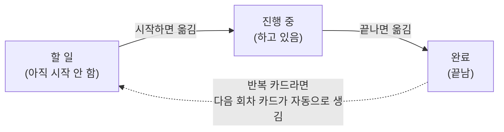

| 용어 | 뜻 |
|---|---|
| 보드 | 카드를 모아 두는 큰 판. 팀·프로젝트마다 하나씩 만들면 좋아요 |
| 열 | 보드 안의 세로 칸. 새 보드는 `할 일` · `진행 중` · `완료` 세 열로 시작해요 |
| 카드 | 일 하나. 제목, 설명, 담당자, 마감일, 체크리스트, 댓글, 첨부파일을 담을 수 있어요 |
| 완료 열 | "끝난 일"을 뜻하는 열. 완료 열의 카드는 마감 알림을 받지 않고, 반복 카드의 기준이 돼요 |

## 2. 접속하기

1. 내 PC에서 SSH 터널을 엽니다. (명령은 [설치 안내서 9단계](DEPLOY-UBUNTU.md#9단계-내-pc에서-접속하기-ssh-터널))
2. 터널 창을 연 채로 브라우저에서 **http://127.0.0.1:3000** 을 엽니다.

처음 접속하면 `내 첫 보드`가 자동으로 만들어져 있습니다. 로그인은 없습니다.

> 화면이 안 열리면: 터널 창이 열려 있는지, 서버에서 앱이 켜져 있는지(`bash ~/deploy/start.sh`) 확인하세요.

## 3. 화면 구성

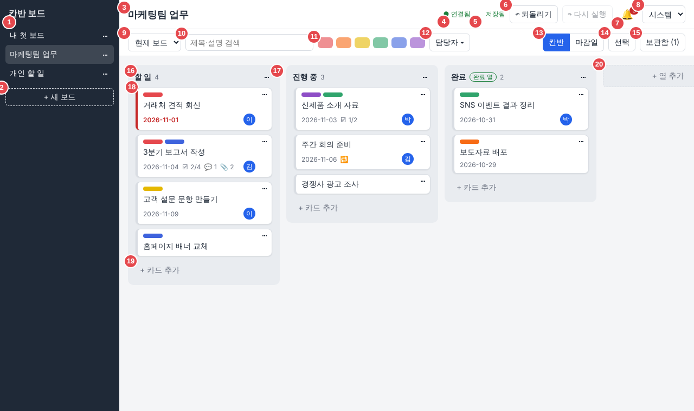

| 번호 | 이름 | 하는 일 |
|---|---|---|
| 1 | 보드 목록 | 누르면 그 보드로 이동. 이름 옆 `⋯`은 보드 메뉴 |
| 2 | `+ 새 보드` | 보드 만들기 |
| 3 | 보드 이름 | 지금 보고 있는 보드 |
| 4 | 연결 상태 | `● 연결됨`이면 다른 탭·다른 사람의 변경이 바로 보여요. `○ 다시 연결 중…`이면 잠시 끊긴 것(자동으로 다시 연결) |
| 5 | 저장 상태 | `저장 중…` → `저장됨`. 실패하면 `저장 실패` ([15장](#15-저장-상태-표시)) |
| 6 | `↶ 되돌리기` · `↷ 다시 실행` | 방금 한 일을 취소하거나 다시 하기 |
| 7 | 🔔 알림 | 마감이 가까운 카드 알림. 숫자는 알림 개수 |
| 8 | 테마 | `시스템` · `밝게` · `어둡게` |
| 9 | 검색 범위 | `현재 보드` 또는 `모든 보드` |
| 10 | 검색칸 | 제목·설명에 들어 있는 글자로 찾기 |
| 11 | 라벨 필터 | 색을 눌러 그 색 라벨이 붙은 카드만 보기 |
| 12 | `담당자 ▾` | 담당자로 걸러 보기 |
| 13 | `칸반` · `마감일` | 보기 방식 바꾸기 |
| 14 | `선택` | 여러 카드를 골라 한꺼번에 옮기기·보관·삭제 |
| 15 | `보관함 (숫자)` | 보관해 둔 카드 보기 |
| 16 | 열 이름과 카드 수 | 이름을 **더블클릭**하면 바로 이름 바꾸기 |
| 17 | 열 메뉴 `⋯` | 이름 변경, 완료 열 지정, 열 순서 바꾸기, 열 삭제 |
| 18 | 카드 | 누르면 카드 창이 열려요. 오른쪽 위 `⋯`은 카드 메뉴 |
| 19 | `+ 카드 추가` | 이 열에 카드 만들기 |
| 20 | `+ 열 추가` | 보드 맨 오른쪽에 열 만들기 |

## 4. 보드

| 하고 싶은 것 | 방법 |
|---|---|
| 새 보드 만들기 | 왼쪽 아래 `+ 새 보드` → 이름 입력 → `Enter` (`Esc`는 취소) |
| 보드 이름 바꾸기 | 보드 이름 옆 `⋯` → `이름 변경` |
| 보드 복제 | `⋯` → `복제`. 이름 뒤에 `(복사본)`이 붙어요 |
| 보드의 보관함 열기 | `⋯` → `보관함` |
| 보드 삭제 | `⋯` → `삭제` → 확인. 그 보드의 열과 카드도 모두 지워져요 (되돌리기로 복원 가능) |

- 새 보드에는 `할 일` · `진행 중` · `완료`(완료 열) 세 열이 미리 들어 있어요.
- **복제**하면 열, 그리고 보관하지 않은 카드와 체크리스트가 복사돼요. 댓글과 첨부파일은 복사되지 않아요.
- 마지막으로 본 보드를 기억해서, 다음에 열면 그 보드가 먼저 보여요.

## 5. 열

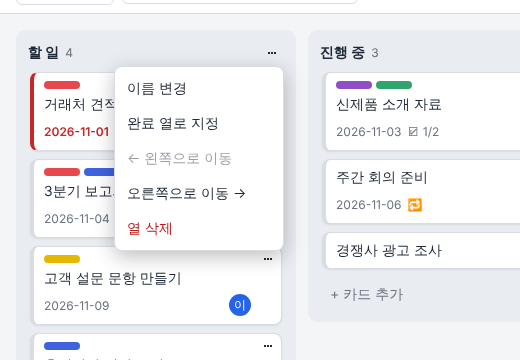

| 하고 싶은 것 | 방법 |
|---|---|
| 열 만들기 | 보드 맨 오른쪽 `+ 열 추가` → 이름 → `Enter` |
| 이름 바꾸기 | 열 이름을 **더블클릭**하거나, `⋯` → `이름 변경` |
| 완료 열로 지정·해제 | `⋯` → `완료 열로 지정` / `완료 열 해제`. 완료 열은 이름 옆에 `완료 열` 표시가 붙어요 |
| 순서 바꾸기 | `⋯` → `← 왼쪽으로 이동` / `오른쪽으로 이동 →` |
| 열 삭제 | `⋯` → `열 삭제` → 확인. 열 안의 카드(보관한 카드 포함)도 함께 지워져요 |

- 완료 열은 여러 개 만들 수 있어요.
- 보드에 열이 하나만 남으면 그 열은 지울 수 없어요.

## 6. 카드

### 6-1. 카드 만들기

1. 열 아래 `+ 카드 추가`를 누릅니다.
2. 제목을 쓰고 `Enter`. 카드가 만들어지고 입력칸이 남아 있어서 **이어서 여러 장**을 만들 수 있어요.
3. 다 쓰면 `Esc`.

> 한글을 쓰다가 `Enter`를 누르면 먼저 글자가 확정되고, 그다음 카드가 **한 번만** 만들어져요.

### 6-2. 카드에 보이는 표시

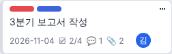

| 표시 | 뜻 |
|---|---|
| 맨 위 색 막대 | 라벨 (여러 개 가능) |
| 날짜 | 마감일. **마감이 지나면 빨간 글씨에 카드 왼쪽이 빨갛게** (완료 열·보관 카드는 제외) |
| 🔁 | 반복 카드 |
| ☑ 2/4 | 체크리스트: 끝낸 항목 / 전체 항목 |
| 💬 1 | 댓글 수 |
| 📎 1 | 첨부파일 수 |
| 오른쪽 동그라미 글자 | 담당자 이름의 첫 글자 (마우스를 올리면 전체 이름) |

### 6-3. 카드 창 (카드를 누르면 열려요)

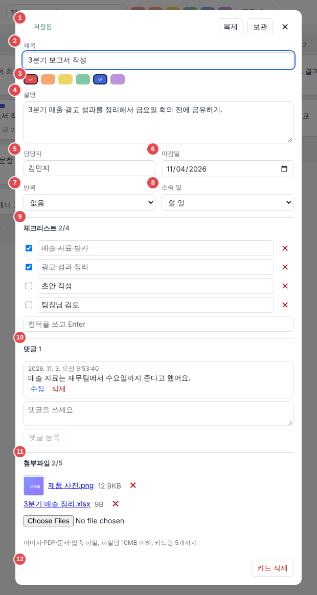

| 번호 | 이름 | 설명 |
|---|---|---|
| 1 | 맨 위 줄 | 저장 상태, `복제`, `보관`, `✕`(닫기) |
| 2 | 제목 | 비워 둘 수 없어요 |
| 3 | 라벨 | 6가지 색 중 눌러서 켜고 끄기 (빨강·주황·노랑·초록·파랑·보라) |
| 4 | 설명 | 자세한 내용 (2,000자까지) |
| 5 | 담당자 | 이름을 직접 쓰거나, 같은 보드에서 썼던 이름을 목록에서 고르기 |
| 6 | 마감일 | 날짜 고르기. 지우면 마감일 없음 |
| 7 | 반복 | `없음` · `매일` · `매주` · `매월` (마감일이 있어야 고를 수 있어요) |
| 8 | 소속 열 | 다른 열을 고르면 카드가 그 열의 **맨 끝**으로 옮겨져요 |
| 9 | 체크리스트 | 할 일 목록 ([6-6](#6-6-체크리스트)) |
| 10 | 댓글 | 메모·대화 ([6-7](#6-7-댓글)) |
| 11 | 첨부파일 | 파일 올리기 ([6-8](#6-8-첨부파일)) |
| 12 | `카드 삭제` | 확인 후 삭제 (되돌리기로 복원 가능) |

- **저장 버튼은 없어요.** 칸에서 다른 곳을 누르거나 창을 닫으면 자동으로 저장돼요.
- 창 닫기: `✕`, `Esc`, 또는 창 바깥의 어두운 곳을 누르기.
- 아직 `Enter`로 추가하지 않은 체크리스트 글이나 `댓글 등록`을 누르지 않은 댓글이 있으면, 닫기 전에 "닫을까요?"라고 물어봐요.
- 저장이 실패하면 쓴 글은 그대로 남아 있고, 맨 위에 `다시 시도` 버튼이 생겨요.

### 6-4. 마감일과 반복 카드

반복을 `매일`·`매주`·`매월`로 정한 카드를 **완료 열로 옮기면**, 다음 회차 카드가 자동으로 생겨요.

| 항목 | 규칙 |
|---|---|
| 새 카드가 생기는 곳 | 같은 보드의 **첫 번째 완료 열이 아닌 열** (보통 `할 일`)의 맨 끝 |
| 새 마감일 | **완료로 옮긴 날** 기준으로 매일 +1일, 매주 +7일, 매월 +1달 (다음 달에 같은 날이 없으면 그 달 마지막 날) |
| 복사되는 것 | 제목, 설명, 라벨, 담당자, 반복 설정, 체크리스트(모두 체크 해제된 상태) |
| 복사되지 않는 것 | 댓글, 첨부파일 |
| 원래 카드 | 완료 열에 그대로 남아요. 한 카드에서 다음 회차는 **한 번만** 생겨요 |

예: `매주` 반복, 마감일 11월 3일인 카드를 11월 5일에 완료 열로 옮기면 → 마감일 **11월 12일**인 새 카드가 `할 일`에 생겨요.

- 마감일을 지우면 반복은 자동으로 `없음`이 돼요.
- 완료 열이 아닌 열이 하나도 없으면, 반복 카드를 완료 열로 옮길 수 없어요 (다음 카드를 놓을 곳이 없어서).

### 6-5. 라벨과 담당자

- 라벨은 한 카드에 여러 색을 붙일 수 있어요. 색의 뜻(예: 빨강 = 급함)은 팀에서 정해 쓰세요.
- 담당자는 50자까지. 같은 보드에서 쓴 이름이 자동으로 목록에 나와요.

### 6-6. 체크리스트

| 하고 싶은 것 | 방법 |
|---|---|
| 항목 추가 | `항목을 쓰고 Enter` 칸에 쓰고 `Enter` |
| 끝냄 표시 | 왼쪽 네모 체크 |
| 글 고치기 | 항목 글을 고치고 다른 곳을 누르기 (창을 `Esc`로 닫아도 저장돼요) |
| 삭제 | 오른쪽 `✕` |

### 6-7. 댓글

- 아래 칸에 쓰고 `댓글 등록`.
- 댓글 아래 `수정` · `삭제`. 고친 댓글에는 `(수정됨)`이 붙어요.

### 6-8. 첨부파일

| 항목 | 내용 |
|---|---|
| 올릴 수 있는 종류 | 이미지 `png jpg jpeg gif webp` · 문서 `pdf txt md csv doc docx xls xlsx ppt pptx hwp hwpx` · 압축 `zip 7z` |
| 크기·개수 | 파일 하나 10MB까지, 카드 하나에 5개까지 |
| 여러 개 한꺼번에 | 가능. 못 올리는 파일이 섞여 있으면 올릴 수 있는 것만 올리고, 못 올린 파일마다 이유를 알려 줘요 |
| 보기 | 이미지는 작은 미리보기가 보여요. 이미지·PDF는 누르면 새 탭에서 열리고, 나머지는 내려받아져요 |
| 삭제 | 파일 옆 `✕`. 실제 파일은 7일 동안 남겨 두어서 그 사이에는 되돌리기로 살릴 수 있어요 |

- SVG 그림과 실행 파일(`exe` 등)은 안전을 위해 올릴 수 없어요.
- 한글 파일 이름도 내려받을 때 그대로 나와요.

### 6-9. 복제 · 보관 · 삭제

| 기능 | 하는 일 |
|---|---|
| 복제 | 바로 아래에 같은 카드를 만들어요. 제목 뒤에 `(복사본)`. 체크리스트(체크 상태 그대로)는 복사, 댓글·첨부는 복사하지 않아요 |
| 보관 | 보드에서 숨겨요. 지우지 않으므로 [보관함](#12-보관함)에서 다시 꺼낼 수 있어요 |
| 삭제 | 확인 후 지워요. `↶ 되돌리기`로 살릴 수 있어요 |

- 보관한 카드는 먼저 복원해야 옮기거나 복제할 수 있어요.

## 7. 카드 옮기기

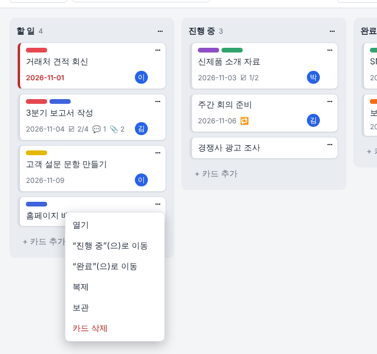

| 방법 | 하는 법 |
|---|---|
| 끌어서 놓기 | 카드를 잡고 원하는 열·자리로 끌어서 놓기. 들어갈 자리가 강조돼 보여요 |
| 카드 메뉴 | 카드 `⋯` → `"열 이름"(으)로 이동` (그 열의 맨 끝으로) |
| 카드 창 | `소속 열`에서 다른 열 고르기 (그 열의 맨 끝으로) |
| 키보드 | 카드에 초점을 두고 `스페이스` → 화살표로 이동 → `스페이스` 또는 `Enter`로 놓기 (`Esc`는 취소) |

**끌어서 옮기기가 안 되는 때** — 이때는 카드 메뉴나 `소속 열`로 옮기세요.

- 검색·필터를 쓰는 중 (화면 위에 안내가 나와요)
- `마감일` 보기, `선택` 모드, `모든 보드` 검색 중

- 다른 보드로는 옮길 수 없어요.

## 8. 되돌리기와 다시 실행

| 동작 | 방법 |
|---|---|
| 되돌리기 | `Ctrl+Z` (Mac은 `⌘+Z`) 또는 `↶ 되돌리기` |
| 다시 실행 | `Ctrl+Shift+Z` (Mac은 `⌘+Shift+Z`) 또는 `↷ 다시 실행` |

- 최대 **50단계**까지 되돌릴 수 있어요. 빠르게 여러 번 눌러도 하나씩 차례로 되돌려요.
- 기록은 **탭마다 따로**이고, **새로고침하면 사라져요.**
- 글을 쓰는 칸 안에서 `Ctrl+Z`를 누르면 그 칸의 글자만 되돌려요.
- 다른 탭이나 다른 사람이 같은 항목을 이미 바꿨다면, 그 내용을 덮어쓰지 않고 이 단계를 **건너뛰고** 알려 줘요.
- 되돌린 내용이 다른 보드의 것이면 그 보드로 화면이 바뀌어요.
- 지운 지 7일이 지난 첨부파일은 되돌리기로 살릴 수 없어요.

## 9. 검색과 필터

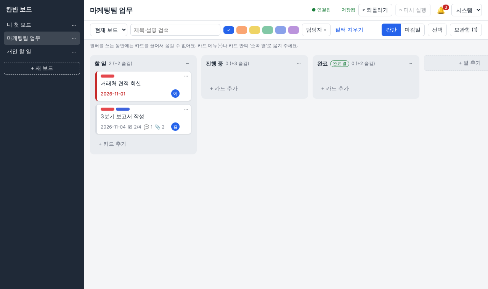

| 방법 | 뜻 |
|---|---|
| 검색칸 | 제목이나 설명에 그 글자가 들어 있는 카드 (영문 대소문자 구분 없음) |
| 라벨 색 버튼 | 고른 색 중 **하나라도** 붙은 카드 |
| `담당자 ▾` | 고른 사람 중 **한 명이라도** 맡은 카드. `담당자 없음`도 고를 수 있어요 |

- 서로 다른 종류를 함께 쓰면 **모두 맞는** 카드만 보여요.
  예: 검색 "보고서" + 빨강 라벨 → 제목·설명에 "보고서"가 있고 빨강 라벨이 붙은 카드
- 걸러져서 안 보이는 카드 수가 열 이름 옆에 `(+숫자 숨김)`으로 나와요.
- `필터 지우기`를 누르면 모두 풀려요.

**모든 보드에서 찾기**

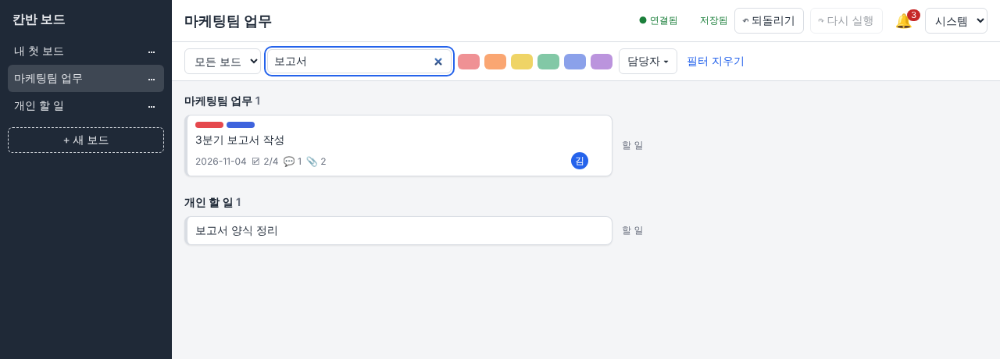

검색 범위를 `모든 보드`로 바꾸면 보드별로 묶어서 보여 줘요. 결과를 누르면 그 보드로 가서 카드 창이 열려요.

## 10. 마감일 보기

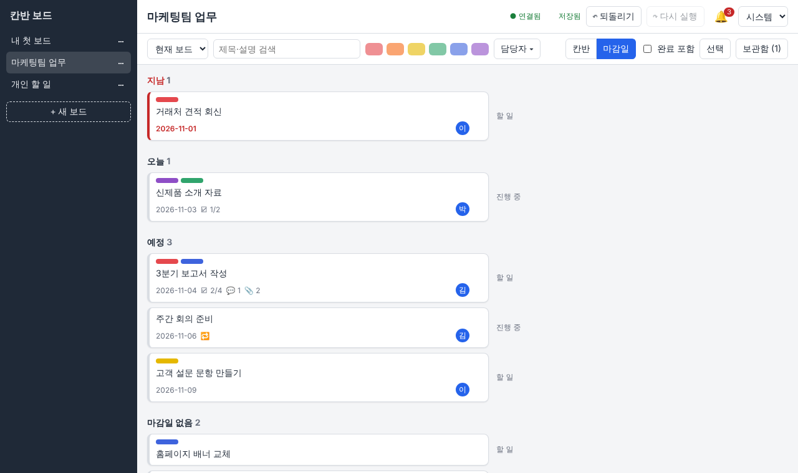

`마감일` 버튼을 누르면 카드를 마감일 순서로 묶어서 보여 줘요.

| 묶음 | 들어가는 카드 |
|---|---|
| 지남 | 마감일이 오늘보다 앞선 카드 |
| 오늘 | 오늘 마감인 카드 |
| 예정 | 내일 이후 마감인 카드 |
| 마감일 없음 | 마감일을 정하지 않은 카드 |

- 완료 열의 카드는 기본으로 숨겨져 있어요. `완료 포함`을 체크하면 보여요.
- 보관한 카드는 나오지 않아요. `칸반`을 누르면 원래 화면으로 돌아가요.

## 11. 여러 카드를 한꺼번에

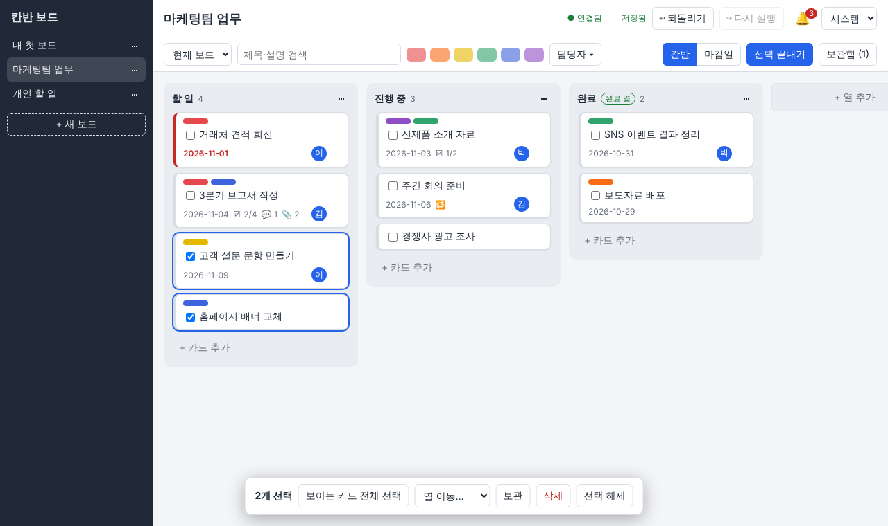

1. 위쪽 `선택`을 누릅니다.
2. 카드를 누를 때마다 골라지고, 다시 누르면 빠져요.
3. 화면 아래 막대에서 고릅니다.

| 버튼 | 하는 일 |
|---|---|
| `보이는 카드 전체 선택` | 지금 화면에 보이는 카드를 모두 고르기 |
| `열 이동…` | 고른 카드를 한 열로 옮기기 |
| `보관` | 고른 카드를 보관 |
| `삭제` | 고른 카드를 삭제 (확인 후) |
| `선택 해제` | 고른 것 모두 풀기 |

- 한꺼번에 한 일은 **되돌리기 한 번**으로 모두 취소돼요.
- 다 쓰면 `선택 끝내기`. 보드·검색·필터·보기 방식을 바꾸면 고른 것이 풀려요.

## 12. 보관함

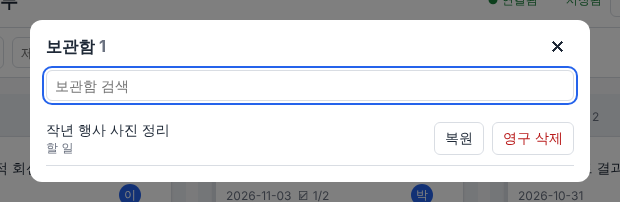

- 위쪽 `보관함 (숫자)` 또는 보드 메뉴 `⋯` → `보관함`.
- `보관함 검색`으로 찾고, `복원`으로 보드에 다시 꺼내거나 `영구 삭제`로 지워요.

## 13. 마감 알림

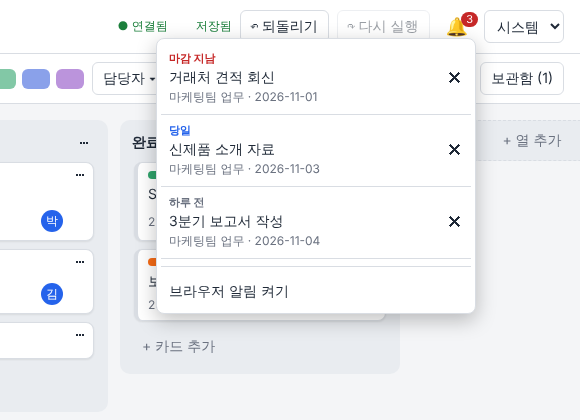

🔔을 누르면 마감 알림이 보여요.

| 알림 | 언제 |
|---|---|
| 하루 전 | 마감일이 내일 |
| 당일 | 마감일이 오늘 |
| 마감 지남 | 마감일이 지남 |

- 완료 열에 있거나 보관한 카드는 알림이 없어요.
- 알림을 누르면 그 카드가 열려요. `✕`로 닫은 알림은 다시 나오지 않아요. 다만 날짜가 지나 단계가 바뀌거나(하루 전 → 당일 → 마감 지남) 마감일을 바꾸면 새 알림이 나와요.
- **브라우저 알림**: 🔔 → `브라우저 알림 켜기` → 브라우저가 묻는 권한을 "허용". 그러면 앱 탭이 열려 있을 때 화면 구석에도 알림이 떠요. 탭을 여러 개 열어도 **한 번만**, 같은 알림은 **하루에 한 번만** 떠요.

## 14. 여러 탭·여러 사람이 함께 쓰기

- 다른 탭이나 다른 사람(같은 서버에 접속한 사람)이 바꾼 내용이 **보통 1초 안에** 내 화면에도 나타나요.
- 내가 쓰고 있던 글은 다른 사람이 같은 카드를 바꿔도 지워지지 않아요.
- 열어 둔 카드를 다른 곳에서 지우면 카드 창이 닫히고 알려 줘요.
- 탭은 여러 개 열어도 괜찮아요 (10개까지 확인했어요).
- 로그인이 없어서 **누가 바꿨는지는 기록되지 않아요.**

## 15. 저장 상태 표시

| 표시 | 뜻 |
|---|---|
| `저장 중…` | 서버에 보내는 중 |
| `저장됨` | 저장 끝 |
| `저장 실패` + 빨간 안내 문구 | 저장하지 못했어요. 화면은 원래대로 돌아가지만 **쓰던 글은 남아 있어요.** 연결을 확인하고 다시 해 보세요 |

변경은 누른 순서대로 하나씩 저장돼요. 화면에는 바로 반영되고, 서버 저장은 뒤따라 끝나요.

## 16. 테마와 휴대폰 화면

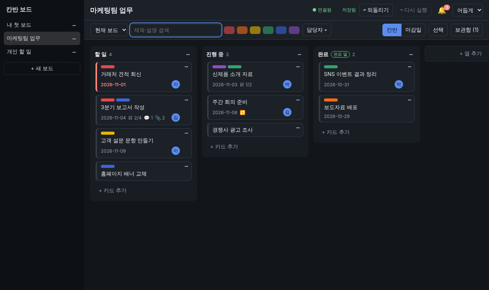

- 오른쪽 위에서 `시스템`(컴퓨터 설정을 따름) · `밝게` · `어둡게`. 고른 테마는 그 브라우저에 기억돼요.

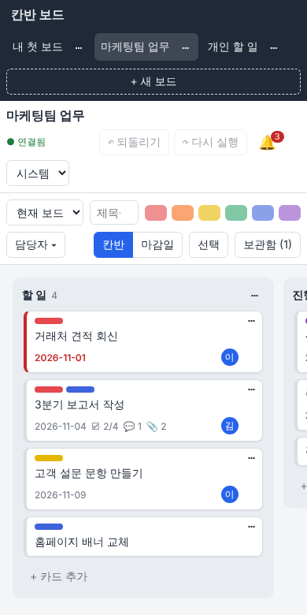

- 휴대폰처럼 좁은 화면에서는 열을 옆으로 밀어서 봐요.

## 17. 키보드 단축키

| 키 | 하는 일 |
|---|---|
| `Ctrl+Z` / `Ctrl+Shift+Z` | 되돌리기 / 다시 실행 (Mac은 `⌘`) |
| `Enter` (카드에 초점) | 카드 창 열기 |
| `스페이스` (카드에 초점) | 카드 끌기 시작 → 화살표로 이동 → `스페이스`·`Enter`로 놓기, `Esc`로 취소 |
| `Enter` (입력칸) | 카드 추가, 체크리스트 추가, 이름 저장 |
| `Esc` | 카드 창·보관함·메뉴·알림 닫기, 입력 취소 |
| `Tab` | 다음 버튼·칸으로 이동 (카드 창이 열려 있으면 창 안에서만 돌아요) |

## 18. 입력 한도

| 항목 | 한도 |
|---|---|
| 보드 이름 · 열 이름 | 50자 |
| 카드 제목 | 100자 |
| 카드 설명 | 2,000자 |
| 담당자 | 50자 |
| 체크리스트 항목 | 500자 |
| 댓글 | 1,000자 |
| 첨부파일 | 파일당 10MB, 카드당 5개 |
| 되돌리기 | 50단계 (탭마다) |
| 마감일 | 1900년 ~ 2999년 |
| 한꺼번에 처리 | 카드 5,000장 |

## 19. 자주 묻는 질문

| 질문 | 답 |
|---|---|
| 저장 버튼이 없어요 | 자동 저장이에요. 칸에서 다른 곳을 누르거나 창을 닫으면 저장돼요 |
| 카드를 실수로 지웠어요 | 바로 `Ctrl+Z`. 이미 새로고침했다면 되돌리기 기록이 없으니, 관리자에게 백업 복원을 부탁하세요 |
| 되돌리기가 안 돼요 | 새로고침하면 기록이 사라져요. 다른 사람이 같은 카드를 바꿨다면 건너뛰어요 |
| 카드를 끌어서 옮길 수 없어요 | 검색·필터, `마감일` 보기, `선택` 모드인지 확인하세요 ([7장](#7-카드-옮기기)) |
| 한글을 치고 Enter를 누르면 카드가 두 장 생겨요 | 생기지 않도록 고쳐져 있어요. 그래도 생기면 쓰는 브라우저 이름과 함께 알려 주세요 |
| 파일이 안 올라가요 | 종류·크기(10MB)·개수(5개)를 확인하세요. 이유가 화면에 나와요 |
| 브라우저 알림이 안 떠요 | 🔔 → `브라우저 알림 켜기`를 했는지, 브라우저에서 이 주소의 알림 권한을 허용했는지, 카드가 완료 열에 있지 않은지 확인하세요 |
| "허용되지 않은 주소(Host)입니다"가 나와요 | 터널의 PC 쪽 포트가 3000이 아니면 생겨요. [설치 안내서 9단계](DEPLOY-UBUNTU.md#9단계-내-pc에서-접속하기-ssh-터널)를 보세요 |
| `○ 다시 연결 중…`이 계속 보여요 | SSH 터널 창이 닫혔거나 PC가 잠들었다 깼을 수 있어요. 터널을 다시 열면 자동으로 이어져요 |
| 화면이 이상해요 | 새로고침(`F5`)해 보세요. 데이터는 서버에 있어서 사라지지 않아요 |
